# Concept dependency graph

Generated by `tools/build-content.mjs` from the `requires:` line of each concept. Do not edit by hand.
An arrow A --> B means: understand A before B.

## Graph

```mermaid
flowchart LR
  subgraph area1["1. Robot bodies"]
    dof["Degrees of freedom"]
    payload["Payload"]
    reach["Reach and workspace"]
    repeatability["Repeatability and accuracy"]
    speed_specs["Speed, acceleration, and cycle specs"]
    six_axis["6-axis articulated arm"]
    scara["SCARA robot"]
    delta["Delta robot"]
    gantry["Gantry (Cartesian) robot"]
    cobot["Collaborative robot (cobot)"]
    mobile_robot["Mobile robots and mobile manipulators"]
    humanoid["Humanoid robots"]
  end
  subgraph area2["2. Inside a joint"]
    joint_stack["The joint as a stack of parts"]
    servo_motor["Electric servo motor"]
    gearbox["Gearbox (reducer) types"]
    encoder["Encoder"]
    brake["Holding brake"]
    servo_drive["Servo drive"]
    torque_sensing["Joint torque sensing"]
    pneumatic_actuation["Pneumatic actuation"]
    hydraulic_actuation["Hydraulic actuation"]
  end
  subgraph area3["3. End effectors"]
    end_effector["End effector and tool center point"]
    vacuum_gripper["Vacuum gripper"]
    soft_gripper["Soft gripper"]
    rigid_gripper["Rigid finger gripper"]
    tool_changer["Tool changer"]
    ft_sensor["Force-torque sensor"]
  end
  subgraph area4["4. Sensors"]
    camera_2d["2D industrial camera"]
    depth_camera["Depth camera"]
    lidar["Lidar"]
    photo_eye["Photo-eyes and proximity sensors"]
    imu["IMU"]
    camera_calibration["Camera calibration"]
    hand_eye_calibration["Camera-to-robot (hand-eye) calibration"]
  end
  subgraph area5["5. Compute and electronics"]
    robot_controller["Robot controller"]
    onboard_compute["Onboard computer and GPU"]
    plc["PLC"]
    industrial_network["Industrial networks"]
    safety_circuit["Safety circuits"]
    estop["Emergency stop"]
  end
  subgraph area6["6. Cell and line"]
    conveyor["Conveyor"]
    feeder["Feeders and denesters"]
    inspection["Inspection and reject"]
    packaging_machines["Lidding and outfeed machines"]
    guarding["Guarding and presence sensing"]
    hmi["HMI"]
    cycle_time["Cycle time, takt time, and throughput"]
    line_balancing["Line balancing and bottlenecks"]
    oee["OEE"]
    ip_rating["IP ratings and washdown"]
    hygienic_design["Hygienic and food-safe design"]
    safety_standards["The main safety standards"]
  end
  subgraph area7["7. Classical robot software"]
    frames["Coordinate frames and transforms"]
    forward_kinematics["Forward kinematics"]
    inverse_kinematics["Inverse kinematics"]
    motion_planning["Motion planning"]
    trajectory_generation["Trajectory generation"]
    collision_checking["Collision checking"]
    control_loops["Control loops"]
    conveyor_tracking["Conveyor tracking"]
    state_machines["State machines and behavior trees"]
    perception["Perception"]
    grasp_planning["Grasp planning"]
    ros2["ROS 2"]
    moveit["MoveIt"]
    opencv["OpenCV and point cloud libraries"]
    vendor_languages["Vendor robot languages"]
    plc_programming["PLC programming"]
  end
  subgraph area8["8. Robot learning"]
    learned_policy["Learned policies and what they replace"]
    imitation_learning["Imitation learning"]
    reinforcement_learning["Reinforcement learning"]
    simulators["Simulators"]
    sim_to_real["Sim-to-real transfer"]
    vla_models["Vision-language-action models"]
    robot_datasets["Robot datasets and data collection"]
    policy_evaluation["Evaluating policies"]
    on_robot_inference["On-robot inference"]
  end
  subgraph area9["9. Teleoperation"]
    teleop_modes["Remote assist versus direct control"]
    operator_interfaces["Operator interfaces"]
    latency_budget["The latency budget"]
    video_pipeline["Video capture and encoding"]
    webrtc["WebRTC"]
    udp_vs_tcp["UDP versus TCP"]
    network_impairments["Jitter, packet loss, and bandwidth"]
    watchdogs["Watchdogs and safe failure"]
  end
  subgraph area10["10. Platform"]
    fleet_management["Fleet management"]
    telemetry_logs["Telemetry and log formats"]
    visualization_tools["Visualization tools"]
    remote_updates["Remote updates and model rollout"]
    data_pipelines["Data pipelines"]
  end
  subgraph area11["11. Deployment lifecycle"]
    scoping["Scoping and ROI"]
    cell_design["Cell design and simulation"]
    purchasing["Purchasing"]
    acceptance_tests["Acceptance tests (FAT and SAT)"]
    commissioning["Commissioning and ramp-up"]
    support["Support and maintenance"]
    raas["Buying a robot versus paying per use"]
  end
  subgraph area12["12. Industry map"]
    value_chain["Who buys from whom"]
    component_makers["Component makers"]
    robot_makers["Robot makers"]
    integrators["System integrators"]
    application_companies["Application companies"]
    model_companies["Robot model companies"]
    tooling_companies["Tooling and software companies"]
    end_users["End users: the plants that run robots"]
  end
  dof --> reach
  payload --> speed_specs
  reach --> speed_specs
  payload --> six_axis
  reach --> six_axis
  repeatability --> six_axis
  speed_specs --> scara
  speed_specs --> delta
  dof --> gantry
  payload --> gantry
  six_axis --> cobot
  dof --> mobile_robot
  mobile_robot --> humanoid
  dof --> joint_stack
  joint_stack --> servo_motor
  servo_motor --> gearbox
  joint_stack --> encoder
  servo_motor --> brake
  servo_motor --> servo_drive
  encoder --> servo_drive
  gearbox --> torque_sensing
  pneumatic_actuation --> hydraulic_actuation
  dof --> end_effector
  frames --> end_effector
  end_effector --> vacuum_gripper
  end_effector --> soft_gripper
  end_effector --> rigid_gripper
  end_effector --> tool_changer
  end_effector --> ft_sensor
  camera_2d --> depth_camera
  depth_camera --> lidar
  camera_2d --> camera_calibration
  frames --> camera_calibration
  camera_calibration --> hand_eye_calibration
  frames --> hand_eye_calibration
  forward_kinematics --> hand_eye_calibration
  servo_drive --> robot_controller
  robot_controller --> onboard_compute
  photo_eye --> plc
  plc --> industrial_network
  robot_controller --> industrial_network
  plc --> safety_circuit
  servo_drive --> safety_circuit
  safety_circuit --> estop
  conveyor --> feeder
  conveyor --> inspection
  camera_2d --> inspection
  conveyor --> packaging_machines
  plc --> hmi
  cycle_time --> line_balancing
  cycle_time --> oee
  ip_rating --> hygienic_design
  guarding --> safety_standards
  dof --> frames
  frames --> forward_kinematics
  encoder --> forward_kinematics
  forward_kinematics --> inverse_kinematics
  reach --> inverse_kinematics
  inverse_kinematics --> motion_planning
  collision_checking --> motion_planning
  motion_planning --> trajectory_generation
  speed_specs --> trajectory_generation
  forward_kinematics --> collision_checking
  servo_drive --> control_loops
  encoder --> control_loops
  conveyor --> conveyor_tracking
  photo_eye --> conveyor_tracking
  trajectory_generation --> conveyor_tracking
  camera_2d --> perception
  depth_camera --> perception
  frames --> perception
  perception --> grasp_planning
  vacuum_gripper --> grasp_planning
  rigid_gripper --> grasp_planning
  ros2 --> moveit
  motion_planning --> moveit
  collision_checking --> moveit
  perception --> opencv
  robot_controller --> vendor_languages
  frames --> vendor_languages
  plc --> plc_programming
  state_machines --> plc_programming
  perception --> learned_policy
  grasp_planning --> learned_policy
  trajectory_generation --> learned_policy
  control_loops --> learned_policy
  learned_policy --> imitation_learning
  learned_policy --> reinforcement_learning
  forward_kinematics --> simulators
  collision_checking --> simulators
  simulators --> sim_to_real
  reinforcement_learning --> sim_to_real
  imitation_learning --> vla_models
  robot_datasets --> vla_models
  imitation_learning --> robot_datasets
  learned_policy --> policy_evaluation
  learned_policy --> on_robot_inference
  onboard_compute --> on_robot_inference
  grasp_planning --> teleop_modes
  teleop_modes --> operator_interfaces
  dof --> operator_interfaces
  teleop_modes --> latency_budget
  camera_2d --> latency_budget
  control_loops --> latency_budget
  camera_2d --> video_pipeline
  latency_budget --> video_pipeline
  video_pipeline --> webrtc
  udp_vs_tcp --> webrtc
  network_impairments --> webrtc
  latency_budget --> udp_vs_tcp
  udp_vs_tcp --> network_impairments
  latency_budget --> network_impairments
  estop --> watchdogs
  robot_controller --> watchdogs
  network_impairments --> watchdogs
  robot_controller --> fleet_management
  mobile_robot --> fleet_management
  ros2 --> telemetry_logs
  telemetry_logs --> visualization_tools
  frames --> visualization_tools
  fleet_management --> remote_updates
  learned_policy --> remote_updates
  telemetry_logs --> data_pipelines
  imitation_learning --> data_pipelines
  cycle_time --> scoping
  scoping --> cell_design
  reach --> cell_design
  safety_standards --> cell_design
  scoping --> purchasing
  purchasing --> acceptance_tests
  cycle_time --> acceptance_tests
  acceptance_tests --> commissioning
  commissioning --> support
  oee --> support
  purchasing --> raas
  support --> raas
  value_chain --> component_makers
  joint_stack --> component_makers
  value_chain --> robot_makers
  robot_controller --> robot_makers
  robot_makers --> integrators
  plc --> integrators
  integrators --> application_companies
  value_chain --> model_companies
  vla_models --> model_companies
  value_chain --> tooling_companies
  simulators --> tooling_companies
  value_chain --> end_users
  oee --> end_users
```

## Reading order by depth

Depth 0 needs nothing else first. Each later depth builds only on earlier ones.

### Depth 0

- **Degrees of freedom** (`dof`, area 1)
- **Payload** (`payload`, area 1)
- **Repeatability and accuracy** (`repeatability`, area 1)
- **Pneumatic actuation** (`pneumatic-actuation`, area 2)
- **2D industrial camera** (`camera-2d`, area 4)
- **Photo-eyes and proximity sensors** (`photo-eye`, area 4)
- **IMU** (`imu`, area 4)
- **Conveyor** (`conveyor`, area 6)
- **Guarding and presence sensing** (`guarding`, area 6)
- **Cycle time, takt time, and throughput** (`cycle-time`, area 6)
- **IP ratings and washdown** (`ip-rating`, area 6)
- **State machines and behavior trees** (`state-machines`, area 7)
- **ROS 2** (`ros2`, area 7)
- **Who buys from whom** (`value-chain`, area 12)

### Depth 1

- **Reach and workspace** (`reach`, area 1) — after `dof`
- **Gantry (Cartesian) robot** (`gantry`, area 1) — after `dof`, `payload`
- **Mobile robots and mobile manipulators** (`mobile-robot`, area 1) — after `dof`
- **The joint as a stack of parts** (`joint-stack`, area 2) — after `dof`
- **Hydraulic actuation** (`hydraulic-actuation`, area 2) — after `pneumatic-actuation`
- **Depth camera** (`depth-camera`, area 4) — after `camera-2d`
- **PLC** (`plc`, area 5) — after `photo-eye`
- **Feeders and denesters** (`feeder`, area 6) — after `conveyor`
- **Inspection and reject** (`inspection`, area 6) — after `conveyor`, `camera-2d`
- **Lidding and outfeed machines** (`packaging-machines`, area 6) — after `conveyor`
- **Line balancing and bottlenecks** (`line-balancing`, area 6) — after `cycle-time`
- **OEE** (`oee`, area 6) — after `cycle-time`
- **Hygienic and food-safe design** (`hygienic-design`, area 6) — after `ip-rating`
- **The main safety standards** (`safety-standards`, area 6) — after `guarding`
- **Coordinate frames and transforms** (`frames`, area 7) — after `dof`
- **Telemetry and log formats** (`telemetry-logs`, area 10) — after `ros2`
- **Scoping and ROI** (`scoping`, area 11) — after `cycle-time`

### Depth 2

- **Speed, acceleration, and cycle specs** (`speed-specs`, area 1) — after `payload`, `reach`
- **6-axis articulated arm** (`six-axis`, area 1) — after `payload`, `reach`, `repeatability`
- **Humanoid robots** (`humanoid`, area 1) — after `mobile-robot`
- **Electric servo motor** (`servo-motor`, area 2) — after `joint-stack`
- **Encoder** (`encoder`, area 2) — after `joint-stack`
- **End effector and tool center point** (`end-effector`, area 3) — after `dof`, `frames`
- **Lidar** (`lidar`, area 4) — after `depth-camera`
- **Camera calibration** (`camera-calibration`, area 4) — after `camera-2d`, `frames`
- **HMI** (`hmi`, area 6) — after `plc`
- **Perception** (`perception`, area 7) — after `camera-2d`, `depth-camera`, `frames`
- **PLC programming** (`plc-programming`, area 7) — after `plc`, `state-machines`
- **Visualization tools** (`visualization-tools`, area 10) — after `telemetry-logs`, `frames`
- **Cell design and simulation** (`cell-design`, area 11) — after `scoping`, `reach`, `safety-standards`
- **Purchasing** (`purchasing`, area 11) — after `scoping`
- **Component makers** (`component-makers`, area 12) — after `value-chain`, `joint-stack`
- **End users: the plants that run robots** (`end-users`, area 12) — after `value-chain`, `oee`

### Depth 3

- **SCARA robot** (`scara`, area 1) — after `speed-specs`
- **Delta robot** (`delta`, area 1) — after `speed-specs`
- **Collaborative robot (cobot)** (`cobot`, area 1) — after `six-axis`
- **Gearbox (reducer) types** (`gearbox`, area 2) — after `servo-motor`
- **Holding brake** (`brake`, area 2) — after `servo-motor`
- **Servo drive** (`servo-drive`, area 2) — after `servo-motor`, `encoder`
- **Vacuum gripper** (`vacuum-gripper`, area 3) — after `end-effector`
- **Soft gripper** (`soft-gripper`, area 3) — after `end-effector`
- **Rigid finger gripper** (`rigid-gripper`, area 3) — after `end-effector`
- **Tool changer** (`tool-changer`, area 3) — after `end-effector`
- **Force-torque sensor** (`ft-sensor`, area 3) — after `end-effector`
- **Forward kinematics** (`forward-kinematics`, area 7) — after `frames`, `encoder`
- **OpenCV and point cloud libraries** (`opencv`, area 7) — after `perception`
- **Acceptance tests (FAT and SAT)** (`acceptance-tests`, area 11) — after `purchasing`, `cycle-time`

### Depth 4

- **Joint torque sensing** (`torque-sensing`, area 2) — after `gearbox`
- **Camera-to-robot (hand-eye) calibration** (`hand-eye-calibration`, area 4) — after `camera-calibration`, `frames`, `forward-kinematics`
- **Robot controller** (`robot-controller`, area 5) — after `servo-drive`
- **Safety circuits** (`safety-circuit`, area 5) — after `plc`, `servo-drive`
- **Inverse kinematics** (`inverse-kinematics`, area 7) — after `forward-kinematics`, `reach`
- **Collision checking** (`collision-checking`, area 7) — after `forward-kinematics`
- **Control loops** (`control-loops`, area 7) — after `servo-drive`, `encoder`
- **Grasp planning** (`grasp-planning`, area 7) — after `perception`, `vacuum-gripper`, `rigid-gripper`
- **Commissioning and ramp-up** (`commissioning`, area 11) — after `acceptance-tests`

### Depth 5

- **Onboard computer and GPU** (`onboard-compute`, area 5) — after `robot-controller`
- **Industrial networks** (`industrial-network`, area 5) — after `plc`, `robot-controller`
- **Emergency stop** (`estop`, area 5) — after `safety-circuit`
- **Motion planning** (`motion-planning`, area 7) — after `inverse-kinematics`, `collision-checking`
- **Vendor robot languages** (`vendor-languages`, area 7) — after `robot-controller`, `frames`
- **Simulators** (`simulators`, area 8) — after `forward-kinematics`, `collision-checking`
- **Remote assist versus direct control** (`teleop-modes`, area 9) — after `grasp-planning`
- **Fleet management** (`fleet-management`, area 10) — after `robot-controller`, `mobile-robot`
- **Support and maintenance** (`support`, area 11) — after `commissioning`, `oee`
- **Robot makers** (`robot-makers`, area 12) — after `value-chain`, `robot-controller`

### Depth 6

- **Trajectory generation** (`trajectory-generation`, area 7) — after `motion-planning`, `speed-specs`
- **MoveIt** (`moveit`, area 7) — after `ros2`, `motion-planning`, `collision-checking`
- **Operator interfaces** (`operator-interfaces`, area 9) — after `teleop-modes`, `dof`
- **The latency budget** (`latency-budget`, area 9) — after `teleop-modes`, `camera-2d`, `control-loops`
- **Buying a robot versus paying per use** (`raas`, area 11) — after `purchasing`, `support`
- **System integrators** (`integrators`, area 12) — after `robot-makers`, `plc`
- **Tooling and software companies** (`tooling-companies`, area 12) — after `value-chain`, `simulators`

### Depth 7

- **Conveyor tracking** (`conveyor-tracking`, area 7) — after `conveyor`, `photo-eye`, `trajectory-generation`
- **Learned policies and what they replace** (`learned-policy`, area 8) — after `perception`, `grasp-planning`, `trajectory-generation`, `control-loops`
- **Video capture and encoding** (`video-pipeline`, area 9) — after `camera-2d`, `latency-budget`
- **UDP versus TCP** (`udp-vs-tcp`, area 9) — after `latency-budget`
- **Application companies** (`application-companies`, area 12) — after `integrators`

### Depth 8

- **Imitation learning** (`imitation-learning`, area 8) — after `learned-policy`
- **Reinforcement learning** (`reinforcement-learning`, area 8) — after `learned-policy`
- **Evaluating policies** (`policy-evaluation`, area 8) — after `learned-policy`
- **On-robot inference** (`on-robot-inference`, area 8) — after `learned-policy`, `onboard-compute`
- **Jitter, packet loss, and bandwidth** (`network-impairments`, area 9) — after `udp-vs-tcp`, `latency-budget`
- **Remote updates and model rollout** (`remote-updates`, area 10) — after `fleet-management`, `learned-policy`

### Depth 9

- **Sim-to-real transfer** (`sim-to-real`, area 8) — after `simulators`, `reinforcement-learning`
- **Robot datasets and data collection** (`robot-datasets`, area 8) — after `imitation-learning`
- **WebRTC** (`webrtc`, area 9) — after `video-pipeline`, `udp-vs-tcp`, `network-impairments`
- **Watchdogs and safe failure** (`watchdogs`, area 9) — after `estop`, `robot-controller`, `network-impairments`
- **Data pipelines** (`data-pipelines`, area 10) — after `telemetry-logs`, `imitation-learning`

### Depth 10

- **Vision-language-action models** (`vla-models`, area 8) — after `imitation-learning`, `robot-datasets`

### Depth 11

- **Robot model companies** (`model-companies`, area 12) — after `value-chain`, `vla-models`

## Prerequisites by concept

| Concept | Area | Requires | Required by |
|---|---|---|---|
| Degrees of freedom | 1 | none | `reach`, `gantry`, `mobile-robot`, `joint-stack`, `end-effector`, `frames`, `operator-interfaces` |
| Payload | 1 | none | `speed-specs`, `six-axis`, `gantry` |
| Reach and workspace | 1 | `dof` | `speed-specs`, `six-axis`, `inverse-kinematics`, `cell-design` |
| Repeatability and accuracy | 1 | none | `six-axis` |
| Speed, acceleration, and cycle specs | 1 | `payload`, `reach` | `scara`, `delta`, `trajectory-generation` |
| 6-axis articulated arm | 1 | `payload`, `reach`, `repeatability` | `cobot` |
| SCARA robot | 1 | `speed-specs` | none |
| Delta robot | 1 | `speed-specs` | none |
| Gantry (Cartesian) robot | 1 | `dof`, `payload` | none |
| Collaborative robot (cobot) | 1 | `six-axis` | none |
| Mobile robots and mobile manipulators | 1 | `dof` | `humanoid`, `fleet-management` |
| Humanoid robots | 1 | `mobile-robot` | none |
| The joint as a stack of parts | 2 | `dof` | `servo-motor`, `encoder`, `component-makers` |
| Electric servo motor | 2 | `joint-stack` | `gearbox`, `brake`, `servo-drive` |
| Gearbox (reducer) types | 2 | `servo-motor` | `torque-sensing` |
| Encoder | 2 | `joint-stack` | `servo-drive`, `forward-kinematics`, `control-loops` |
| Holding brake | 2 | `servo-motor` | none |
| Servo drive | 2 | `servo-motor`, `encoder` | `robot-controller`, `safety-circuit`, `control-loops` |
| Joint torque sensing | 2 | `gearbox` | none |
| Pneumatic actuation | 2 | none | `hydraulic-actuation` |
| Hydraulic actuation | 2 | `pneumatic-actuation` | none |
| End effector and tool center point | 3 | `dof`, `frames` | `vacuum-gripper`, `soft-gripper`, `rigid-gripper`, `tool-changer`, `ft-sensor` |
| Vacuum gripper | 3 | `end-effector` | `grasp-planning` |
| Soft gripper | 3 | `end-effector` | none |
| Rigid finger gripper | 3 | `end-effector` | `grasp-planning` |
| Tool changer | 3 | `end-effector` | none |
| Force-torque sensor | 3 | `end-effector` | none |
| 2D industrial camera | 4 | none | `depth-camera`, `camera-calibration`, `inspection`, `perception`, `latency-budget`, `video-pipeline` |
| Depth camera | 4 | `camera-2d` | `lidar`, `perception` |
| Lidar | 4 | `depth-camera` | none |
| Photo-eyes and proximity sensors | 4 | none | `plc`, `conveyor-tracking` |
| IMU | 4 | none | none |
| Camera calibration | 4 | `camera-2d`, `frames` | `hand-eye-calibration` |
| Camera-to-robot (hand-eye) calibration | 4 | `camera-calibration`, `frames`, `forward-kinematics` | none |
| Robot controller | 5 | `servo-drive` | `onboard-compute`, `industrial-network`, `vendor-languages`, `watchdogs`, `fleet-management`, `robot-makers` |
| Onboard computer and GPU | 5 | `robot-controller` | `on-robot-inference` |
| PLC | 5 | `photo-eye` | `industrial-network`, `safety-circuit`, `hmi`, `plc-programming`, `integrators` |
| Industrial networks | 5 | `plc`, `robot-controller` | none |
| Safety circuits | 5 | `plc`, `servo-drive` | `estop` |
| Emergency stop | 5 | `safety-circuit` | `watchdogs` |
| Conveyor | 6 | none | `feeder`, `inspection`, `packaging-machines`, `conveyor-tracking` |
| Feeders and denesters | 6 | `conveyor` | none |
| Inspection and reject | 6 | `conveyor`, `camera-2d` | none |
| Lidding and outfeed machines | 6 | `conveyor` | none |
| Guarding and presence sensing | 6 | none | `safety-standards` |
| HMI | 6 | `plc` | none |
| Cycle time, takt time, and throughput | 6 | none | `line-balancing`, `oee`, `scoping`, `acceptance-tests` |
| Line balancing and bottlenecks | 6 | `cycle-time` | none |
| OEE | 6 | `cycle-time` | `support`, `end-users` |
| IP ratings and washdown | 6 | none | `hygienic-design` |
| Hygienic and food-safe design | 6 | `ip-rating` | none |
| The main safety standards | 6 | `guarding` | `cell-design` |
| Coordinate frames and transforms | 7 | `dof` | `end-effector`, `camera-calibration`, `hand-eye-calibration`, `forward-kinematics`, `perception`, `vendor-languages`, `visualization-tools` |
| Forward kinematics | 7 | `frames`, `encoder` | `hand-eye-calibration`, `inverse-kinematics`, `collision-checking`, `simulators` |
| Inverse kinematics | 7 | `forward-kinematics`, `reach` | `motion-planning` |
| Motion planning | 7 | `inverse-kinematics`, `collision-checking` | `trajectory-generation`, `moveit` |
| Trajectory generation | 7 | `motion-planning`, `speed-specs` | `conveyor-tracking`, `learned-policy` |
| Collision checking | 7 | `forward-kinematics` | `motion-planning`, `moveit`, `simulators` |
| Control loops | 7 | `servo-drive`, `encoder` | `learned-policy`, `latency-budget` |
| Conveyor tracking | 7 | `conveyor`, `photo-eye`, `trajectory-generation` | none |
| State machines and behavior trees | 7 | none | `plc-programming` |
| Perception | 7 | `camera-2d`, `depth-camera`, `frames` | `grasp-planning`, `opencv`, `learned-policy` |
| Grasp planning | 7 | `perception`, `vacuum-gripper`, `rigid-gripper` | `learned-policy`, `teleop-modes` |
| ROS 2 | 7 | none | `moveit`, `telemetry-logs` |
| MoveIt | 7 | `ros2`, `motion-planning`, `collision-checking` | none |
| OpenCV and point cloud libraries | 7 | `perception` | none |
| Vendor robot languages | 7 | `robot-controller`, `frames` | none |
| PLC programming | 7 | `plc`, `state-machines` | none |
| Learned policies and what they replace | 8 | `perception`, `grasp-planning`, `trajectory-generation`, `control-loops` | `imitation-learning`, `reinforcement-learning`, `policy-evaluation`, `on-robot-inference`, `remote-updates` |
| Imitation learning | 8 | `learned-policy` | `vla-models`, `robot-datasets`, `data-pipelines` |
| Reinforcement learning | 8 | `learned-policy` | `sim-to-real` |
| Simulators | 8 | `forward-kinematics`, `collision-checking` | `sim-to-real`, `tooling-companies` |
| Sim-to-real transfer | 8 | `simulators`, `reinforcement-learning` | none |
| Vision-language-action models | 8 | `imitation-learning`, `robot-datasets` | `model-companies` |
| Robot datasets and data collection | 8 | `imitation-learning` | `vla-models` |
| Evaluating policies | 8 | `learned-policy` | none |
| On-robot inference | 8 | `learned-policy`, `onboard-compute` | none |
| Remote assist versus direct control | 9 | `grasp-planning` | `operator-interfaces`, `latency-budget` |
| Operator interfaces | 9 | `teleop-modes`, `dof` | none |
| The latency budget | 9 | `teleop-modes`, `camera-2d`, `control-loops` | `video-pipeline`, `udp-vs-tcp`, `network-impairments` |
| Video capture and encoding | 9 | `camera-2d`, `latency-budget` | `webrtc` |
| WebRTC | 9 | `video-pipeline`, `udp-vs-tcp`, `network-impairments` | none |
| UDP versus TCP | 9 | `latency-budget` | `webrtc`, `network-impairments` |
| Jitter, packet loss, and bandwidth | 9 | `udp-vs-tcp`, `latency-budget` | `webrtc`, `watchdogs` |
| Watchdogs and safe failure | 9 | `estop`, `robot-controller`, `network-impairments` | none |
| Fleet management | 10 | `robot-controller`, `mobile-robot` | `remote-updates` |
| Telemetry and log formats | 10 | `ros2` | `visualization-tools`, `data-pipelines` |
| Visualization tools | 10 | `telemetry-logs`, `frames` | none |
| Remote updates and model rollout | 10 | `fleet-management`, `learned-policy` | none |
| Data pipelines | 10 | `telemetry-logs`, `imitation-learning` | none |
| Scoping and ROI | 11 | `cycle-time` | `cell-design`, `purchasing` |
| Cell design and simulation | 11 | `scoping`, `reach`, `safety-standards` | none |
| Purchasing | 11 | `scoping` | `acceptance-tests`, `raas` |
| Acceptance tests (FAT and SAT) | 11 | `purchasing`, `cycle-time` | `commissioning` |
| Commissioning and ramp-up | 11 | `acceptance-tests` | `support` |
| Support and maintenance | 11 | `commissioning`, `oee` | `raas` |
| Buying a robot versus paying per use | 11 | `purchasing`, `support` | none |
| Who buys from whom | 12 | none | `component-makers`, `robot-makers`, `model-companies`, `tooling-companies`, `end-users` |
| Component makers | 12 | `value-chain`, `joint-stack` | none |
| Robot makers | 12 | `value-chain`, `robot-controller` | `integrators` |
| System integrators | 12 | `robot-makers`, `plc` | `application-companies` |
| Application companies | 12 | `integrators` | none |
| Robot model companies | 12 | `value-chain`, `vla-models` | none |
| Tooling and software companies | 12 | `value-chain`, `simulators` | none |
| End users: the plants that run robots | 12 | `value-chain`, `oee` | none |
