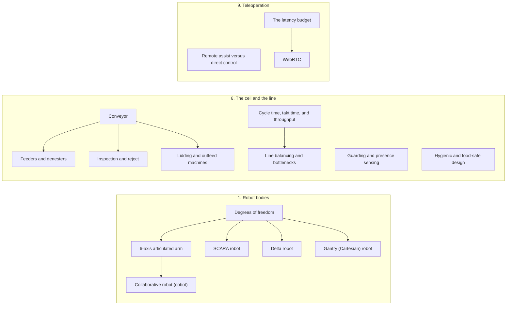

# Concept dependency graph

Generated by `tools/build-content.mjs` from the `requires:` line of each concept. Do not edit by hand.
An arrow A --> B means: understand A before B.

## Graph

## Reading order by depth

Depth 0 needs nothing else first. Each later depth builds only on earlier ones.

### Depth 0

- **Degrees of freedom** (`dof`, area 1)
- **Conveyor** (`conveyor`, area 6)
- **Guarding and presence sensing** (`guarding`, area 6)
- **Cycle time, takt time, and throughput** (`cycle-time`, area 6)
- **Hygienic and food-safe design** (`hygienic-design`, area 6)
- **Remote assist versus direct control** (`teleop-modes`, area 9)
- **The latency budget** (`latency-budget`, area 9)

### Depth 1

- **6-axis articulated arm** (`six-axis`, area 1) — after `dof`
- **SCARA robot** (`scara`, area 1) — after `dof`
- **Delta robot** (`delta`, area 1) — after `dof`
- **Gantry (Cartesian) robot** (`gantry`, area 1) — after `dof`
- **Feeders and denesters** (`feeder`, area 6) — after `conveyor`
- **Inspection and reject** (`inspection`, area 6) — after `conveyor`
- **Lidding and outfeed machines** (`packaging-machines`, area 6) — after `conveyor`
- **Line balancing and bottlenecks** (`line-balancing`, area 6) — after `cycle-time`
- **WebRTC** (`webrtc`, area 9) — after `latency-budget`

### Depth 2

- **Collaborative robot (cobot)** (`cobot`, area 1) — after `six-axis`

## Prerequisites by concept

| Concept | Area | Requires | Required by |
|---|---|---|---|
| Degrees of freedom | 1 | none | `six-axis`, `scara`, `delta`, `gantry` |
| 6-axis articulated arm | 1 | `dof` | `cobot` |
| SCARA robot | 1 | `dof` | none |
| Delta robot | 1 | `dof` | none |
| Collaborative robot (cobot) | 1 | `six-axis` | none |
| Gantry (Cartesian) robot | 1 | `dof` | none |
| Conveyor | 6 | none | `feeder`, `inspection`, `packaging-machines` |
| Feeders and denesters | 6 | `conveyor` | none |
| Inspection and reject | 6 | `conveyor` | none |
| Lidding and outfeed machines | 6 | `conveyor` | none |
| Guarding and presence sensing | 6 | none | none |
| Cycle time, takt time, and throughput | 6 | none | `line-balancing` |
| Line balancing and bottlenecks | 6 | `cycle-time` | none |
| Hygienic and food-safe design | 6 | none | none |
| Remote assist versus direct control | 9 | none | none |
| The latency budget | 9 | none | `webrtc` |
| WebRTC | 9 | `latency-budget` | none |
